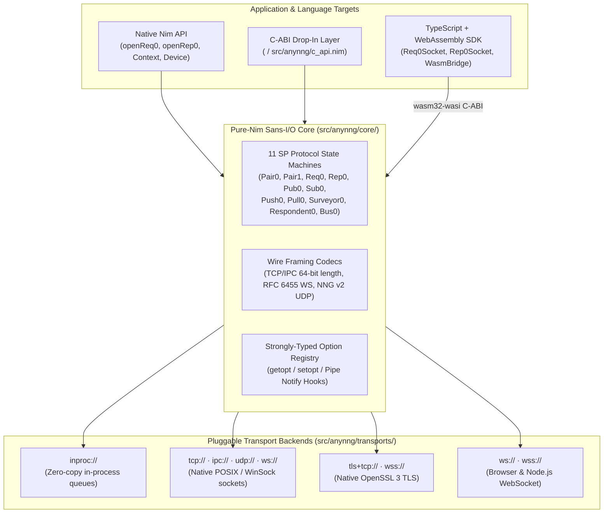

# anynng

[](#status)
[](https://github.com/elijahr/anynng/actions/workflows/ci.yml)
[](https://elijahr.github.io/anynng/)
[](https://github.com/elijahr/anynng/releases/latest)
[](LICENSE)
[](https://nim-lang.org)

> [!WARNING]
> **Experimental / Pre-Alpha Software — Not Ready for Production**
> This project is an active research and development prototype. APIs, ABI layouts, and wire formats are unstable and subject to breaking changes without notice. Do not use in production systems.

**`anynng`** is a pure-Nim, multi-target (`C`, `JS`, `WASM`) and multi-transport (`tcp://`, `tls+tcp://`, `ws://`, `wss://`, `ipc://`, `udp://`, `inproc://`) implementation of the **[NNG (Nanomsg-Next-Gen) v2.1.0](https://nng.nanomsg.org/) Scalability Protocols**.

Built around a deterministic, zero-copy **Sans-I/O protocol state machine**, `anynng` compiles to:
1. **Native Nim** (`nim c` / `nim js`) with ergonomic high-level APIs and concurrent `Context` multiplexing.
2. **A drop-in `<nng/nng.h>` C-ABI library** (`src/anynng/c_api.nim`) verified against upstream `nanomsg/nng` NUTS specification test suites and continuously checked for struct/signature parity via [HeaderKit](https://github.com/axiomantic/headerkit) `NimBackend`.
3. **A ~42 KB WebAssembly (`wasm32-wasi`) + TypeScript SDK** (`src/anynng/wasm_bridge.nim` + `ts/index.ts`) bringing binary NNG Scalability Protocols (`pair.sp.nanomsg.org`, `req.sp.nanomsg.org`, etc.) to browsers and Node.js over WebSockets.

---

## Architecture



---

## Supported Scalability Protocols

All 11 NNG Scalability Protocol roles are implemented in the shared Sans-I/O engine (`src/anynng/core/protocols/`) and exposed identically across Nim, C-ABI, and TypeScript/WASM:

| Family | Protocol Roles | Subprotocol Header (`WS` / `TCP`) | Topology & Semantics |
| :--- | :--- | :--- | :--- |
| **Pair v0** | `PAIR0` (`openPair0`) | `pair.sp.nanomsg.org` | Exclusive 1-to-1 bidirectional peer communication |
| **Pair v1** | `PAIR1` (`openPair1`) | `pair1.sp.nanomsg.org` | Point-to-point and polyamorous mode with hop-count TTL |
| **Req/Rep v0** | `REQ0` / `REP0` (`openReq0`, `openRep0`) | `req.sp.nanomsg.org` / `rep.sp.nanomsg.org` | Stateless RPC with request IDs, backtrace stacks, automatic retry timers, and concurrent `Context` multiplexing |
| **Pub/Sub v0** | `PUB0` / `SUB0` (`openPub0`, `openSub0`) | `pub.sp.nanomsg.org` / `sub.sp.nanomsg.org` | Topic-prefix fan-out broadcast (`subscribe` / `unsubscribe`) |
| **Pipeline v0** | `PUSH0` / `PULL0` (`openPush0`, `openPull0`) | `push.sp.nanomsg.org` / `pull.sp.nanomsg.org` | Round-robin load-balanced fan-out and fair-queued fan-in |
| **Survey v0** | `SURVEYOR0` / `RESPONDENT0` (`openSurveyor0`, `openRespondent0`) | `surveyor.sp.nanomsg.org` / `respondent.sp.nanomsg.org` | Timed broadcast queries (`surveyTime`) with aggregated responses |
| **Bus v0** | `BUS0` (`openBus0`) | `bus.sp.nanomsg.org` | Many-to-many mesh broadcast across all connected peers |

---

## Supported Transports

| Scheme | Native Nim / C-ABI | JS / WASM | Description |
| :--- | :---: | :---: | :--- |
| `inproc://` | Yes | Yes | Lock-free in-process message passing across sockets and contexts |
| `tcp://` | Yes | — | Standard NNG `\0\0SP\0` 8-byte handshake + 64-bit big-endian length framing |
| `tls+tcp://` | Yes | — | Encrypted TCP transport backed by OpenSSL 3 (`TlsConfig`) |
| `ipc://` | Yes | — | Unix domain sockets with NNG SP stream framing |
| `udp://` | Yes | — | Connectionless NNG v2 UDP datagram framing (`SP\0` + peer refresh) |
| `ws://` | Yes | Yes | RFC 6455 binary WebSocket frames with `<proto>.sp.nanomsg.org` subprotocol negotiation |
| `wss://` | Yes | Yes | TLS-encrypted WebSocket transport (OpenSSL 3 on native; standard `WebSocket` on JS/WASM) |

---

## Usage Examples

### 1. Native Nim API

Install via Nimble:

```bash
nimble install anynng
```

#### Request / Reply (`REQ0` / `REP0`)

```nim
import anynng

let rep = openRep0()
let req = openReq0()

let listener = rep.listen("inproc://service")
req.dial("inproc://service")

req.send("ping")
doAssert rep.hasRecv()
doAssert rep.recvStr() == "ping"

rep.send("pong")
doAssert req.hasRecv()
doAssert req.recvStr() == "pong"

listener.close()
req.close()
rep.close()
```

#### Publish / Subscribe (`PUB0` / `SUB0`) with Topic Filtering

```nim
import anynng

let pub = openPub0()
let subTech = openSub0()
let subAlerts = openSub0()

let listener = pub.listen("inproc://events")

subTech.subscribe("news.tech:")
subAlerts.subscribe("alerts:")

subTech.dial("inproc://events")
subAlerts.dial("inproc://events")

pub.send("news.tech: anynng v0.2.0")
pub.send("alerts: high cpu load")

doAssert subTech.recvStr() == "news.tech: anynng v0.2.0"
doAssert not subTech.hasRecv()

doAssert subAlerts.recvStr() == "alerts: high cpu load"

listener.close()
subTech.close()
subAlerts.close()
pub.close()
```

### 2. Drop-In `<nng/nng.h>` C-ABI & HeaderKit Verification

`src/anynng/c_api.nim` exports the NNG v2.1.0 C-ABI (`nng_pair0_open`, `nng_req0_open`, `nng_rep0_open`, `nng_listen`, `nng_dial`, `nng_send`, `nng_recv`, `nng_aio_*`, `nng_ctx_*`, `nng_pipe_*`, `nng_stats_*`, etc.) and links directly against unmodified C callers and the upstream `nanomsg/nng` NUTS specification test suite.

C-ABI structural layout and function signatures are verified against upstream `<nng/nng.h>` using [HeaderKit](https://github.com/axiomantic/headerkit)'s `NimBackend`:

```bash
# Verify C-ABI parity and generate CFFI / .pyi declarations via HeaderKit NimBackend
just verify-abi

# Run upstream nanomsg/nng NUTS specification test suites against anynng's C-ABI
just test-nng-spec
```

### 3. TypeScript & WebAssembly SDK

`anynng` compiles its Sans-I/O protocol core to a standalone `wasm32-wasi` module (`dist/anynng.wasm`) driven by strongly-typed TypeScript socket classes (`Req0Socket`, `Rep0Socket`, `Pub0Socket`, `Sub0Socket`, `Pair0Socket`, `Pair1Socket`, `Push0Socket`, `Pull0Socket`, `Surveyor0Socket`, `Respondent0Socket`, `Bus0Socket`):

```typescript
import { Req0Socket, Rep0Socket } from "@axiomantic/anynng";

const req = new Req0Socket("ws://127.0.0.1:8080", { resendTime: 1000 });
await req.connect();

await req.send(new TextEncoder().encode("hello from TypeScript + WASM"));
const reply = await req.recv(2000);
console.log(new TextDecoder().decode(reply));

req.close();
```

---

## Development & Testing

The [`justfile`](justfile) is the canonical command surface for building, testing, and verifying `anynng`:

```bash
just setup          # Install Nim, Node.js, and docs dependencies
just test           # Run full Nim + TypeScript/WASM test suites
just test-nim       # Run Nim unit & C libnng interop test suites
just test-ts        # Compile WASM bridge and run Vitest E2E suite
just test-nng-spec  # Run upstream nanomsg/nng NUTS C-ABI specification tests
just verify-abi     # Verify C-ABI against upstream <nng/nng.h> via HeaderKit NimBackend
just lint           # Run nph formatting check, nimble check, and tsc --noEmit
just fmt            # Auto-format Nim (nph) and TypeScript (prettier)
just docs           # Generate API docs and launch local Starlight dev server
just docs-build     # Build production static documentation site
```

## License

Licensed under the [MIT License](LICENSE).
