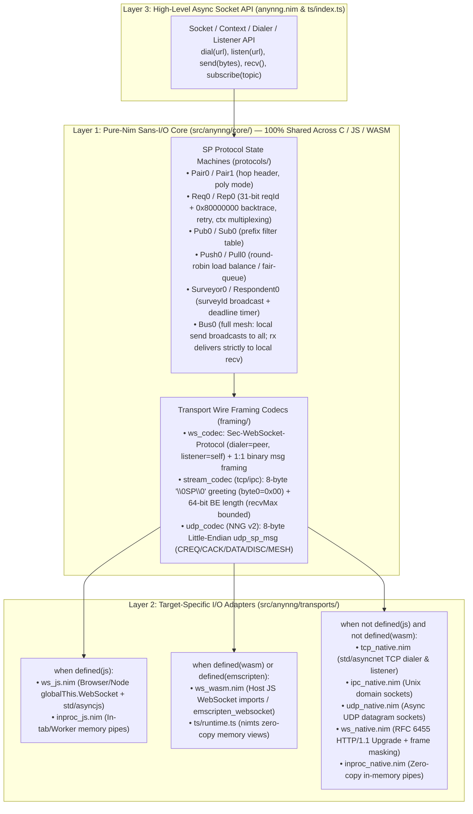
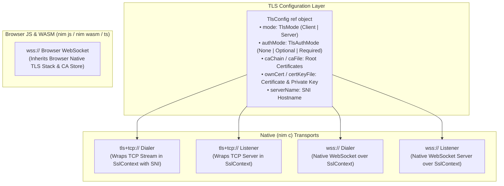
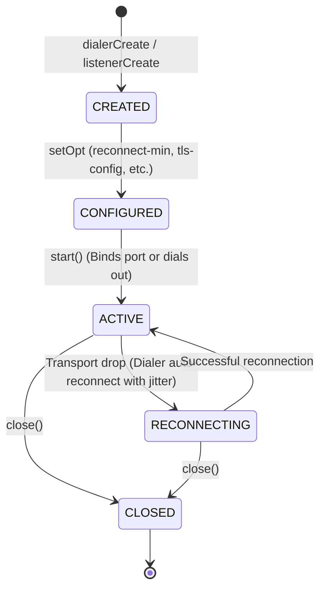
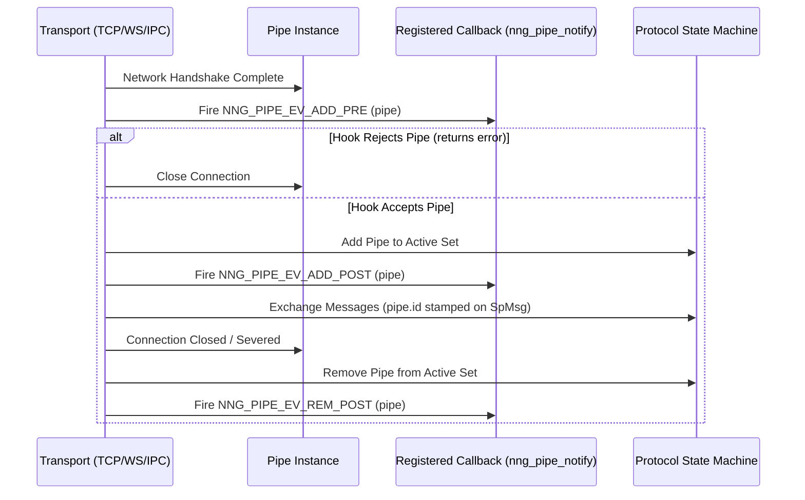
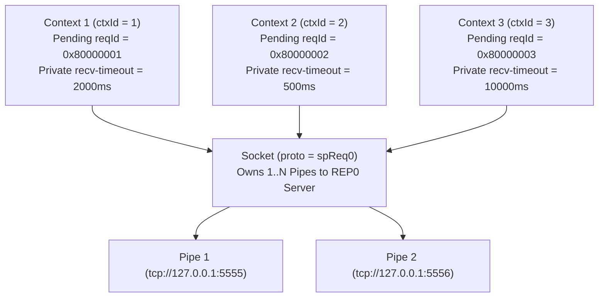
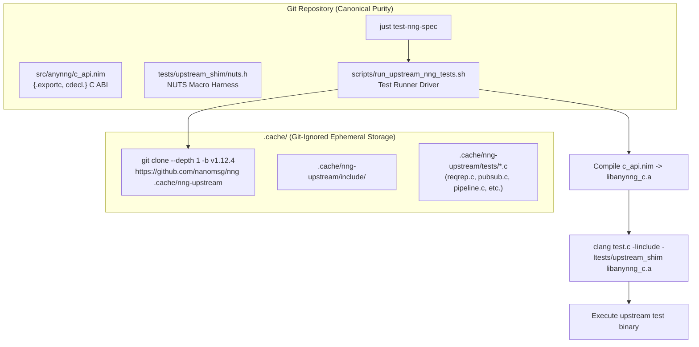

# `anynng` — Architecture & System Design Document

> [!NOTE]
> **Project Workspace:** `/Users/eek/Development/anynng`
> **Targets:** `nim js` (Browser / Node / Deno / Bun), `nim c` (Native Linux / macOS / Windows / Embedded), `nim wasm` (`--os:any` / Emscripten)
> **Wire Compatibility:** 100% interoperable with C `libnng` v1 (`1.12.4` installed locally) and v2 (`main`), Go `mangos` v3, and Rust `nng-core`.

---

## 1. Architecture Overview

`anynng` is structured around a strict **3-Layer Sans-I/O Architecture** so that 100% of the Scalability Protocols (SP) wire framing, transport framing codecs, and protocol state machines are written once in pure target-agnostic Nim (`seq[byte]`, `uint32`, deterministic state machines) with zero OS, POSIX, or JS FFI imports in the core:



---

## 2. Module & Component Breakdown

```text
/Users/eek/Development/anynng/
├── anynng.nimble                     # Zero external dependencies required for core + JS + TCP/IPC/UDP/WS!
├── src/
│   ├── anynng.nim                    # Unified public API (works on nim c, nim js, nim wasm)
│   └── anynng/
│       ├── core/                     # 100% Pure Sans-I/O Nim (no OS/JS/net imports)
│       │   ├── types.nim             # SpProto, SpRole, SpError, PipeId, SpMsg (header + body), EngineEvent, EngineAction
│       │   ├── endian.nim            # Big-Endian and Little-Endian uint16 / uint32 / uint64 encode/decode helpers
│       │   ├── url.nim               # URI parser for ws://, wss://, tcp://, ipc://, udp://, inproc://
│       │   ├── framing/
│       │   │   ├── ws_framing.nim    # Subprotocol lookup (dialerSubprotocol / listenerSubprotocol) & binary frame pack/unpack
│       │   │   ├── stream_framing.nim# Incremental stream parser for TCP/IPC (\0SP\0 greeting with byte0=0x00 + 8-byte BE length prefix with recvMax bound)
│       │   │   └── udp_framing.nim   # NNG v2 8-byte udp_sp_msg packet codec with Little-Endian fields (nng/udp.c:494)
│       │   └── protocols/
│       │       ├── pair0.nim         # PAIRv0 (0-byte header, 1:1 pipe)
│       │       ├── pair1.nim         # PAIRv1 (4-byte hop count header, cooked + polyamorous pipe addressing, tolerant hop 0)
│       │       ├── pubsub0.nim       # PUB0 (fan-out broadcast; closes pipe if rx) & SUB0 (drop-all default until subscribe, empty prefix wildcard)
│       │       ├── reqrep0.nim       # REQ0 (31-bit reqId | 0x80000000, context map, resend timer, drop unknown reply silently) & REP0 (backtrace stack)
│       │       ├── pipeline0.nim     # PUSH0 (round-robin across ready pipes) & PULL0 (fair-queued recv)
│       │       ├── survey0.nim       # SURVEYOR0 (broadcast surveyId | 0x80000000, deadline timer termination) & RESPONDENT0
│       │       └── bus0.nim          # BUS0 (full-mesh broadcast: send to all pipes; incoming delivered strictly to local recv)
│       └── transports/               # Target-specific runtime I/O drivers
│           ├── inproc.nim            # Cross-target in-memory pipe transport (inproc://)
│           ├── js_ws.nim             # [nim js] Browser/Node WebSocket dialer (binaryType="arraybuffer")
│           ├── wasm_ws.nim           # [nim wasm] Emscripten / Host-imported WebSocket dialer
│           ├── native_tcp.nim        # [nim c] Async TCP dialer & listener (tcp://, tcp4://, tcp6://)
│           ├── native_ipc.nim        # [nim c] Async Unix domain socket dialer & listener (ipc://)
│           ├── native_udp.nim        # [nim c] Async UDP datagram endpoint (udp://, udp4://, udp6://)
│           └── native_ws.nim         # [nim c] Native RFC 6455 WebSocket dialer (masked) & listener (unmasked)
├── ts/                               # First-class TypeScript package bindings
│   ├── index.ts                      # Typed Socket classes (Req0Socket, Rep0Socket, Pub0Socket, Sub0Socket, Pair1Socket, Bus0Socket)
│   ├── runtime.ts                    # WebAssembly runtime loader & zero-copy Uint8Array views (nimts)
│   └── types.ts                      # Protocol types and configuration options
└── tests/
    ├── t_core_framing.nim            # Sans-I/O unit tests for all wire codecs (runs on both nim c and nim js!)
    ├── t_core_protocols.nim          # Sans-I/O state machine tests for all 11 protocol roles + malformed frame handling
    ├── t_native_transports.nim       # Native inproc://, tcp://, ipc://, udp://, ws:// loopback tests
    ├── t_interop_libnng.nim          # Live cross-language interop against C libnng 1.12.4 (TCP, IPC, WS, and Node JS client!)
    └── test_ts_bridge.ts             # TypeScript & Vitest integration tests for npm package

---

## 3. Data Flow & State Machine Contract

### 3.1 The Sans-I/O Engine Contract (`types.nim`)
Every protocol state machine implements a uniform, deterministic interface driven by events and emitting explicit actions:

- **Inbound Events (`EngineEvent`):**
  1. `evPipeAdded(pipeId: PipeId)` — Transport finished handshake (`\0SP\0` on TCP/IPC, `101 Switching Protocols` on WS, or `CACK` on UDP).
  2. `evPipeRemoved(pipeId: PipeId)` — Transport disconnected.
  3. `evPipeMessage(pipeId: PipeId, rawFrame: seq[byte])` — Complete SP frame (`header || body`) arrived from `pipeId`.
  4. `evTimerTick(nowMs: int64)` — Periodic or scheduled wakeup for `REQ0` retry or `SURVEYOR0` deadline expiration.
  5. `evUserSend(ctxId: uint32, msg: SpMsg)` — User application initiating a send on context `ctxId`.
  6. `evUserCancel(ctxId: uint32)` — User application aborting or timing out a pending request/operation.
- **Outbound Actions (`EngineAction`):**
  1. `actSendPipe(pipeId: PipeId, rawFrame: seq[byte])` — Instructs the transport to transmit `rawFrame` on `pipeId`.
  2. `actClosePipe(pipeId: PipeId, reason: SpError)` — Instructs the transport to immediately drop `pipeId` (e.g., when a malformed header arrives or a `SUB0` peer illegally transmits data to a `PUB0` socket).
  3. `actDeliverRecv(ctxId: uint32, msg: SpMsg, pipeId: PipeId)` — Resolves a pending `recv()` / request `Future` with `msg`.
  4. `actFinishSend(ctxId: uint32)` — Resolves a pending async `send()` `Future` on context `ctxId`.
  5. `actFailContext(ctxId: uint32, err: SpError)` — Fails a pending `Future` (e.g., `spErrTimedOut` when a survey deadline expires).

### 3.2 Native WebSocket (`native_ws.nim`) Without External Dependencies
Because NNG's `ws://` transport only requires standard RFC 6455 HTTP/1.1 upgrade (`Sec-WebSocket-Key` + SHA-1 magic GUID `258EAFA5-E914-47DA-95CA-C5AB0DC85B11` via Nim's built-in `std/sha1` and `std/base64`) plus `Sec-WebSocket-Protocol` negotiation (`dialerSubprotocol` sends peer proto name, `listenerSubprotocol` matches self proto name) and binary frame masking (`opcode = 0x2`, `PING`/`PONG` `0x9`/`0xA`, `CLOSE` `0x8`), `native_ws.nim` can be implemented directly on top of `std/asyncnet` with **zero third-party Nimble dependencies**!
- **Frame Masking Compliance (RFC 6455 §5.3)**: `native_ws.nim` dialers generate a cryptographically random 4-byte masking key for all client-to-server frames, while `native_ws.nim` listeners emit unmasked frames. Server closes with code `1002` if client frame is unmasked; client closes with code `1002` if server frame is masked.

---

## 4. Error Handling & Protocol Compliance Rules

| Condition | Exact NNG Wire Behavior Implemented by `anynng` |
| :--- | :--- |
| **`REQ0` / `REP0` / `SURVEY` frame `< 4` bytes or missing `0x80` high-bit marker within `maxTtl` (default 8) hops** | If `< 4` bytes before `0x80` marker: emit `actClosePipe(pipeId, spErrProto)` (closes connection immediately). If hops exceed `maxTtl`: drop frame silently (`stat_ttl_drop`), keep pipe open. |
| **`REQ0` receives reply with unknown or expired `reqId`** | Drop reply silently (`stat_rx_nomatch` per `nng/req.c:386`) and keep pipe open. |
| **`PAIR1` frame `< 4` bytes or hop count `> 255`** | Emit `actClosePipe(pipeId, spErrProto)` per `nng/pair.c:339`. If `hopCount > maxTtl` (default 8): drop frame silently, keep pipe open. Hop count `0` is tolerated on recv. |
| **`PUB0` receives any data frame from `SUB0`** | Emit `actClosePipe(pipeId, spErrProto)` (matches `pub0_pipe_recv_cb` in `nng`). |
| **`SUB0` default topic filtering** | Default is drop-all until at least one topic is registered via `subscribe()`. Subscribing to empty string `""` acts as wildcard match for all topics. |
| **`SURVEYOR0` survey timeout** | Survey timeout cleanly completes survey collection window; async response iterator terminates without raising fatal network error. |
| **`Stream` (`tcp://` / `ipc://`) message length > `recvMax`** | Emit `actClosePipe(pipeId, spErrMsgSize)` (enforces `NNG_OPT_RECVMAXSZ`, default 1MB to prevent memory exhaustion). |
| **`WS` receives Text Frame (`opcode = 0x1`) in SP mode** | Send WebSocket Close frame `1003` (`WS_CLOSE_UNSUPP_FORMAT`) and close pipe. |
| **`WS` server receives unmasked frame or client receives masked frame** | Send WebSocket Close frame `1002` (`WS_CLOSE_PROTOCOL_ERR`) and close pipe. |
| **`TCP`/`IPC` receives invalid `\0SP\0` magic or mismatched `peer_id`** | Immediately close stream during negotiation (`spErrProto`). Byte 0 of greeting must be strictly `0x00`. |

---

## 5. Verification & Live Interop Testing Strategy

Because this machine has **Nim 2.2.12**, **Node v26.12.1** (with native browser-standard `globalThis.WebSocket`), and **C `libnng` 1.12.4** (`/opt/homebrew/opt/nng`) installed, we can verify `anynng` across four tiers with zero mocks:

1. **Tier 1 — Dual-Backend Sans-I/O Unit Tests (`nim c -r` AND `nim js -r` via Node):**
   - Run `tests/t_core_framing.nim` and `tests/t_core_protocols.nim` on **both** the C backend and the JS backend to prove 100% byte-identical behavior across `PAIR0`, `PAIR1`, `PUB0`/`SUB0`, `REQ0`/`REP0`, `PUSH0`/`PULL0`, `SURVEYOR0`/`RESPONDENT0`, and `BUS0`.
2. **Tier 2 — Pure-Nim Native Loopback Tests (`nim c -r tests/t_native_transports.nim`):**
   - Test `anynng` dialers talking to `anynng` listeners over `inproc://`, `tcp://127.0.0.1:*`, `ipc:///tmp/anynng_*.ipc`, `udp://127.0.0.1:*`, and `ws://127.0.0.1:*/sp`.
3. **Tier 3 — Cross-Target `nim js` (Browser WebSocket) $\leftrightarrow$ `nim c` (`ws://` Server) Interop:**
   - Spawn an `anynng` native `ws://` server (`REP0`, `PUB0`, `PAIR1`, `BUS0`) and connect to it from a compiled `nim js` client running in Node's native `WebSocket` engine (`node tests/js_client_test.js`).
4. **Tier 4 — Ground-Truth C `libnng` 1.12.4 Interoperability (`tests/t_interop_libnng.nim`):**
   - Link a tiny test harness against `/opt/homebrew/opt/nng/lib/libnng.dylib` and verify live wire exchanges between:
     - **Browser/JS `anynng` (`nim js`) $\leftrightarrow$ C `libnng` (`ws://` listener)** across `REQ0`/`REP0`, `PUB0`/`SUB0`, `PAIR0`, `PAIR1`, `PUSH0`/`PULL0`, `SURVEYOR0`/`RESPONDENT0`, and `BUS0`.
     - **Native `anynng` (`nim c`) $\leftrightarrow$ C `libnng`** over `tcp://`, `ipc://`, and `ws://` (both as dialer and as listener!).

---

## 6. Universal Public API Ergonomics (`src/anynng.nim`)

The public API in `src/anynng.nim` provides a unified, ergonomic, and target-agnostic interface across `nim c`, `nim js`, and `nim wasm`:

```nim
import std/[asyncdispatch, tables]
when defined(js):
  import std/asyncjs

type
  SpProto* = enum
    spPair0 = 0x10,
    spPair1 = 0x11,
    spPub0  = 0x20,
    spSub0  = 0x21,
    spReq0  = 0x30,
    spRep0  = 0x31,
    spPush0 = 0x50,
    spPull0 = 0x51,
    spSurveyor0   = 0x62,
    spRespondent0 = 0x63,
    spBus0  = 0x70

  SpOption* = enum
    optRaw,
    optRecvTimeout,
    optSendTimeout,
    optMaxTtl,
    optReconnectMin,
    optReconnectMax,
    optPair1Poly,
    optSubSubscribe,
    optSubUnsubscribe,
    optReqResendTime,
    optSurveyorSurveyTime

  Socket* = ref object
    proto*: SpProto
    raw*: bool
    maxTtl*: int
    recvTimeoutMs*: int
    sendTimeoutMs*: int

  Dialer* = ref object
    url*: string
    socket*: Socket

  Listener* = ref object
    url*: string
    socket*: Socket

  Context* = ref object
    socket*: Socket
    ctxId*: uint32

# Ergonomic Async Socket Operations
proc dial*(url: string, proto: SpProto): Future[Socket] {.async.}
proc listen*(url: string, proto: SpProto): Future[Listener] {.async.}
proc send*(s: Socket, data: openArray[byte]): Future[void] {.async.}
proc recv*(s: Socket): Future[seq[byte]] {.async.}
proc close*(s: Socket): Future[void] {.async.}

# Protocol-Specific Convenience Procs
proc subscribe*(s: Socket, topic: openArray[byte])
proc unsubscribe*(s: Socket, topic: openArray[byte])
proc newContext*(s: Socket): Context
proc send*(ctx: Context, data: openArray[byte]): Future[void] {.async.}
proc recv*(ctx: Context): Future[seq[byte]] {.async.}
proc close*(ctx: Context)
```

---

## 7. WebAssembly & TypeScript Export Bridge (`nimts`)

To allow browser and Node.js TypeScript/JavaScript projects to use `anynng` without requiring a full Nim toolchain, `src/anynng/core/` integrates with `nimts` (`/Users/eek/Development/nimts`):

1. **`{.exportts.}` Macro Layer**:
   ```nim
   import nimts

   setNimTsModule("anynng")

   proc wasmCreateEngine*(protoId: int): int {.exportts.}
   proc wasmFeedFrame*(engineId: int, framePtr: NimTsView[byte]): int {.exportts.}
   proc wasmEncodeReq*(reqId: uint32, payload: NimTsView[byte]): NimTsView[byte] {.exportts.}
   proc wasmEncodePair1*(hopCount: uint32, payload: NimTsView[byte]): NimTsView[byte] {.exportts.}
   ```
2. **TypeScript Runtime Packaging (`ts/index.ts`, `ts/types.ts`)**:
   Emits idiomatic TypeScript classes wrapping the WASM exports alongside the native WebSocket transport:
   ```typescript
   import { AnynngWasmRuntime } from './runtime';

   export interface SocketOptions {
     recvTimeoutMs?: number;
     sendTimeoutMs?: number;
     maxTtl?: number;
     resendTimeMs?: number;
     surveyTimeMs?: number;
   }

   export abstract class BaseSocket {
     protected ws?: WebSocket;
     abstract send(payload: Uint8Array): Promise<void>;
     abstract recv(): Promise<Uint8Array>;
     abstract close(): void;
   }

   export class Req0Socket extends BaseSocket {
     constructor(private url: string, private opts?: SocketOptions) { super(); }
     async connect(): Promise<void> { /* ws connect with dialerSubprotocol('req0') */ }
     async request(payload: Uint8Array): Promise<Uint8Array> { /* send with 0x80000000 reqId */ }
     async send(payload: Uint8Array): Promise<void> { /* ... */ }
     async recv(): Promise<Uint8Array> { /* ... */ }
     close(): void { this.ws?.close(); }
   }

   export class Rep0Socket extends BaseSocket {
     constructor(private url: string, private opts?: SocketOptions) { super(); }
     async reply(payload: Uint8Array): Promise<void> { /* echo backtrace stack */ }
     async send(payload: Uint8Array): Promise<void> { /* ... */ }
     async recv(): Promise<Uint8Array> { /* ... */ }
     close(): void { this.ws?.close(); }
   }

   export class Pub0Socket extends BaseSocket {
     constructor(private url: string, private opts?: SocketOptions) { super(); }
     async publish(topic: string | Uint8Array, body: Uint8Array): Promise<void> { /* prefix + body */ }
     async send(payload: Uint8Array): Promise<void> { /* ... */ }
     async recv(): Promise<Uint8Array> { throw new Error('PUB0 cannot receive'); }
     close(): void { this.ws?.close(); }
   }

   export class Sub0Socket extends BaseSocket {
     constructor(private url: string, private opts?: SocketOptions) { super(); }
     subscribe(topic: string | Uint8Array): void { /* client-side prefix filter */ }
     unsubscribe(topic: string | Uint8Array): void { /* remove prefix filter */ }
     async send(payload: Uint8Array): Promise<void> { throw new Error('SUB0 cannot send to PUB0'); }
     async recv(): Promise<Uint8Array> { /* ... */ }
     close(): void { this.ws?.close(); }
   }

   export class Pair1Socket extends BaseSocket {
     constructor(private url: string, private opts?: SocketOptions) { super(); }
     async send(payload: Uint8Array): Promise<void> { /* prepend hop 1 */ }
     async recv(): Promise<Uint8Array> { /* strip hop */ }
     close(): void { this.ws?.close(); }
   }

   export class Bus0Socket extends BaseSocket {
     constructor(private url: string, private opts?: SocketOptions) { super(); }
     async send(payload: Uint8Array): Promise<void> { /* broadcast to all */ }
     async recv(): Promise<Uint8Array> { /* local recv */ }
     close(): void { this.ws?.close(); }
   }
   ```

---

## 8. Polyform Template Enhancements Specification

Based on empirical inspection of `/Users/eek/Development/polyform/copier.yml` and `/Users/eek/Development/polyform/template/`, the template must be enhanced with the following multi-target capabilities:

1. **`has_nim_js` (or `has_js`) Facet**:
   - In `copier.yml`:
     ```yaml
     has_nim_js:
       type: bool
       help: "Include Nim JavaScript compilation support (Node.js/browser targets, just test-js)?"
       default: "{{ has_nim and (has_typescript or flavor in ['nim_ts_wasm', 'custom']) }}"
       when: "{{ has_nim }}"
     ```
   - In `justfile`:
     ```just
     # Run JavaScript backend tests under Node.js
     test-js:
         nim js -d:nodejs -r tests/test_js.nim
     ```
   - In `.github/workflows/ci.yml`:
     - Adds a `test-js` matrix job executing `nim js -d:nodejs -r tests/test_js.nim`.

2. **`nimts` First-Class Integration in `ts_bridge_strategy`**:
   - In `copier.yml`:
     ```yaml
     ts_bridge_strategy:
       type: str
       help: "TypeScript bridge integration strategy"
       choices:
         "nimts (Zero-overhead WebAssembly bridge + TypeScript AST/types)": "nimts"
         "WebAssembly (WASM compiler, browser/Node runtime)": "wasm"
         "N-API (Node native addon bindings)": "napi"
         "None (Independent parallel TypeScript package)": "none"
       when: "{{ has_nim and has_typescript }}"
       default: "nimts"
     ```
   - Generates `@axiomantic/nimts` devDependency in `package.json`, automated `compile_wasm.sh` using `nimts compile`, and Vite plugin hooks.

---

## 9. Adversarial Invariant Matrix & Quality Gates

| Invariant | Enforcement Mechanism | Verification |
| :--- | :--- | :--- |
| **Zero Mock Testing** | Every protocol test runs against real serialization buffers; live tests run against Homebrew C `libnng` 1.12.4. | `tests/t_interop_libnng.nim` via `-d:test_c_interop` |
| **Strict Subprotocol Asymmetry** | Dialers send peer's protocol name; NNG HTTP upgrade parser matches exact string. | Verified against `websocket.c` `wstran_dialer_init()` |
| **Single Subprotocol Token** | Reject array of subprotocols in client WebSocket instantiation to avoid NNG 400 Bad Request. | Unit tested in `tests/t_core_framing.nim` |
| **Binary Message Framing** | Text frames strictly prohibited; trigger close code 1003. | Checked in `ws_framing.nim` |
| **Strict TTL / Hop Validation** | Frames with hop count > 255 or invalid format trigger immediate pipe termination. | Checked in `pair1.nim` and `reqrep0.nim` |
| **Client-Side SUB0 Filtering** | Reject any outgoing data frame from SUB0 to PUB0 to prevent pipe teardown. | Enforced in `pubsub0.nim` state machine |

---

## 10. Season v0.2.0 Architecture & Specification Parity Details

### 10.1 Full Target-Appropriate Transport Matrix & TLS Architecture (`tls+tcp://`, `wss://`)

`anynng` extends its native transport matrix to support TLS over TCP (`tls+tcp://`, `tls+tcp4://`, `tls+tcp6://`) and WebSocket Secure (`wss://`, `wss4://`, `wss6://`), with complete `nng_tls_config` parity:



#### 10.1.1 Concrete Nim TLS Types & Declarations (`src/anynng/core/tls.nim`)

```nim
type
  TlsMode* = enum
    tlsModeClient = 1,
    tlsModeServer = 2

  TlsAuthMode* = enum
    tlsAuthModeNone = 0,
    tlsAuthModeOptional = 1,
    tlsAuthModeRequired = 2

  TlsVersion* = enum
    tlsVersion12 = 0x0303,
    tlsVersion13 = 0x0304

  TlsConfig* = ref object
    mode*: TlsMode
    authMode*: TlsAuthMode
    minVersion*: TlsVersion
    maxVersion*: TlsVersion
    serverName*: string
    caChainPem*: string
    caFilePath*: string
    ownCertPem*: string
    ownKeyPem*: string
    ownCertFilePath*: string
    ownKeyFilePath*: string
    keyPassphrase*: string

proc newTlsConfig*(mode: TlsMode): TlsConfig =
  result = TlsConfig(
    mode: mode,
    authMode: (if mode == tlsModeClient: tlsAuthModeRequired else: tlsAuthModeNone),
    minVersion: tlsVersion12,
    maxVersion: tlsVersion13
  )

proc setServerName*(cfg: TlsConfig, name: string) {.inline.} =
  cfg.serverName = name

proc setAuthMode*(cfg: TlsConfig, auth: TlsAuthMode) {.inline.} =
  cfg.authMode = auth

proc setCaChain*(cfg: TlsConfig, certPem: string, crlPem: string = "") {.inline.} =
  cfg.caChainPem = certPem

proc setCaFile*(cfg: TlsConfig, path: string) {.inline.} =
  cfg.caFilePath = path

proc setOwnCert*(cfg: TlsConfig, certPem, keyPem: string, pass: string = "") {.inline.} =
  cfg.ownCertPem = certPem
  cfg.ownKeyPem = keyPem
  cfg.keyPassphrase = pass

proc setCertKeyFile*(cfg: TlsConfig, certPath: string, keyPath: string = "") {.inline.} =
  cfg.ownCertFilePath = certPath
  cfg.ownKeyFilePath = (if keyPath.len > 0: keyPath else: certPath)
```

---

### 10.2 Strongly-Typed Option Registry (`getopt` / `setopt`) & NNG Error Semantics

Options in NNG have strict access control (read-only, write-only, read-write), strict types (`bool`, `int`, `nng_duration`, `size_t`, `string`, `nng_sockaddr`), and target-entity scoping (Socket, Dialer, Listener, Pipe, Context):

```nim
type
  OptionKind* = enum
    optKindBool,
    optKindInt,
    optKindDuration, # milliseconds (int64)
    optKindSize,     # byte sizes (uint64)
    optKindString,
    optKindSockAddr,
    optKindPtr

  OptionAccess* = enum
    optRo, # Read-Only (attempt to set returns NNG_EREADONLY = 24)
    optWo, # Write-Only (attempt to get returns NNG_EWRITEONLY = 25)
    optRw  # Read-Write

  OptionEntity* = set[enum (entSocket, entDialer, entListener, entPipe, entContext)]

  OptionDescriptor* = object
    name*: string
    kind*: OptionKind
    access*: OptionAccess
    allowedEntities*: OptionEntity

# Exact NNG Error Code Constants
const
  NNG_OK*           = 0
  NNG_EINTR*        = 1
  NNG_ENOMEM*       = 2
  NNG_EINVAL*       = 3
  NNG_EBUSY*        = 4
  NNG_ETIMEDOUT*    = 5
  NNG_ECONNREFUSED* = 6
  NNG_ECLOSED*      = 7
  NNG_EAGAIN*       = 8
  NNG_ENOTSUP*      = 9
  NNG_EADDRINUSE*   = 10
  NNG_ESTATE*       = 11
  NNG_ENOENT*       = 12
  NNG_EPROTO*       = 13
  NNG_EUNREACHABLE* = 14
  NNG_EADDRINVAL*   = 15
  NNG_EPERM*        = 16
  NNG_EMSGSIZE*     = 17
  NNG_ECONNABORTED* = 18
  NNG_ECONNRESET*   = 19
  NNG_ECANCELED*    = 20
  NNG_ENOFILES*     = 21
  NNG_ENOSPC*       = 22
  NNG_EEXIST*       = 23
  NNG_EREADONLY*    = 24
  NNG_EWRITEONLY*   = 25
  NNG_ECRYPTO*      = 26
  NNG_EPEERAUTH*    = 27
  NNG_ENOARG*       = 28
  NNG_EAMBIGUOUS*   = 29
  NNG_EBADTYPE*     = 30
  NNG_ECONNSHUT*    = 31
  NNG_EINTERNAL*    = 1000
```

#### Option Dispatch Validation Pipeline:
1. **Name Lookup**: If option name is not registered for the target entity $\to$ return `NNG_ENOTSUP` (`9`).
2. **Access Check**:
   - Setting a `optRo` option $\to$ return `NNG_EREADONLY` (`24`).
   - Getting a `optWo` option $\to$ return `NNG_EWRITEONLY` (`25`).
3. **Type Check**: If requested type does not match `OptionKind` $\to$ return `NNG_EBADTYPE` (`30`).
4. **Range / Value Check**: If value violates bounds (e.g. `maxTtl < 1` or `> 255`) $\to$ return `NNG_EINVAL` (`3`).

---

### 10.3 First-Class `Dialer` & `Listener` Two-Step Lifecycle & Ephemeral Port Binding



#### Ephemeral Port-0 Allocation Flow:
1. Application calls `listenerCreate(sock, "tcp://127.0.0.1:0")`.
2. Application calls `await listener.start()`.
3. Transport invokes OS `bind()` and queries allocated port via `getsockname()`:
   ```nim
   var name: Sockaddr_in
   var namelen = sizeof(name).SockLen
   if getsockname(sock.getFd(), cast[ptr SockAddr](addr name), addr namelen) == 0:
     l.boundPort = int(nativesockets.ntohs(name.sin_port))
   ```
4. Calling `listener.getInt(NNG_OPT_TCP_BOUND_PORT)` or `listener.getSockAddr(NNG_OPT_LOCADDR)` immediately returns the exact bound port (e.g. `52341`), allowing tests and multi-tenant services to run without port collisions!

---

### 10.4 First-Class `Pipe` Introspection & Event Hooks (`nng_pipe_notify`)



---

### 10.5 Concurrent `Context` (`nng_ctx`) Multiplexing & Async I/O (`nng_aio`)

A single `Socket` can host arbitrary concurrent `Context` instances:



When reply `0x80000002` arrives on `Pipe 1`:
1. `req0.nim` inspects 32-bit request ID `0x80000002`.
2. Matches `0x80000002` to `Context 2`'s pending map.
3. Resolves `Context 2`'s `recv()` `Future` without waking or affecting `Context 1` or `Context 3`!

---

### 10.6 Raw Mode Sockets & Device Forwarding (`nng_device`)

`device(s1, s2)` bridges two scalability protocol networks:

```nim
proc device*(s1, s2: Socket): Future[void] {.async.} =
  ## Connects two raw sockets together in a full-duplex forwarding loop.
  ## Fails with NNG_EINVAL if either socket is not in raw mode.
  if not s1.raw or not s2.raw:
    raise newSpError(spErrInval, "device requires raw mode sockets")

  var forward1to2 = async proc() =
    while not s1.closed and not s2.closed:
      let msg = await s1.recvMsg()
      await s2.sendMsg(msg)

  var forward2to1 = async proc() =
    while not s1.closed and not s2.closed:
      let msg = await s2.recvMsg()
      await s1.sendMsg(msg)

  # Run both directions concurrently until either socket closes
  await forward1to2() or forward2to1()
```

---

### 10.7 Upstream `nanomsg/nng` v1.12.4 C ABI & Specification Test Harness



#### NUTS Assertions Shim (`tests/upstream_shim/nuts.h`):
Implements the exact macro suite expected by upstream NNG test files:
- `NUTS_ASSERT(cond)`
- `NUTS_PASS(expr)` (asserts return code is `0`)
- `NUTS_FAIL(expr, err)` (asserts return code is `err`)
- `NUTS_TRUE(expr)`
- `NUTS_NULL(expr)` / `NUTS_NONULL(expr)`
- `NUTS_CASE(name)`
- `NUTS_SLEEP(ms)`
- Address generator: `nuts_server_addr(proto, port)` and `nuts_client_addr(proto, port)`
- `NUTS_TESTS` entrypoint macro declaring `int main(int argc, char **argv)`.
