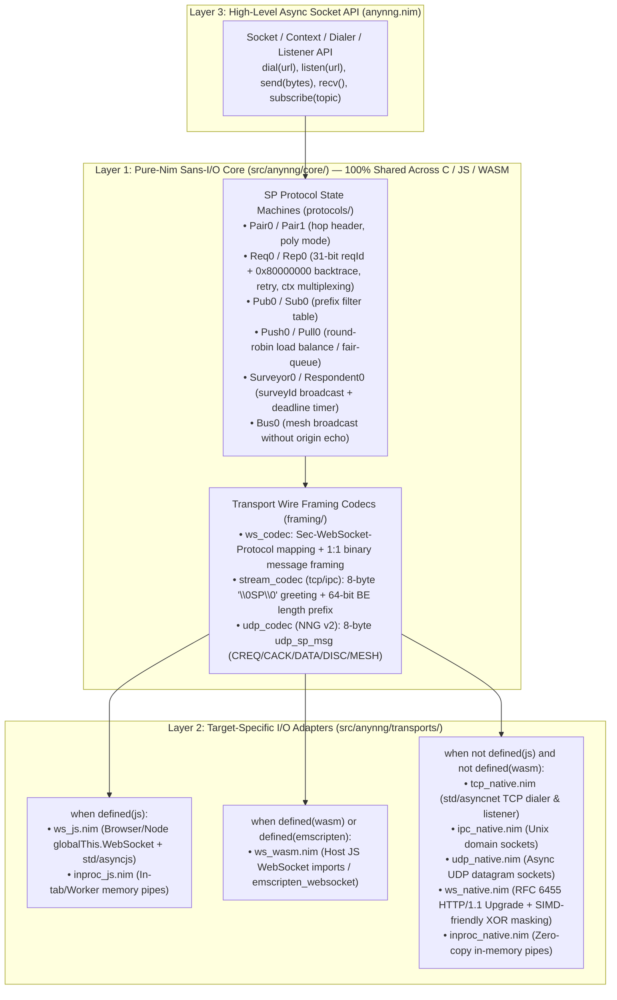

# `anynng` — Architecture & System Design Document

> [!NOTE]
> **Project Workspace:** `/Users/eek/.gemini/antigravity/scratch/anynng`
> **Targets:** `nim js` (Browser / Node / Deno / Bun), `nim c` (Native Linux / macOS / Windows / Embedded), `nim wasm` (`--os:any` / Emscripten)
> **Wire Compatibility:** 100% interoperable with C `libnng` v1 (`1.12.4` installed locally) and v2 (`main`), Go `mangos` v3, and Rust `nng-core`.

---

## 1. Architecture Overview

`anynng` is structured around a strict **3-Layer Sans-I/O Architecture** so that 100% of the Scalability Protocols (SP) wire framing, transport framing codecs, and protocol state machines are written once in pure target-agnostic Nim (`seq[byte]`, `uint32`, deterministic state machines) with zero OS, POSIX, or JS FFI imports in the core:



---

## 2. Module & Component Breakdown

```text
/Users/eek/.gemini/antigravity/scratch/anynng/
├── anynng.nimble                     # Zero external dependencies required for core + JS + TCP/IPC/UDP/WS!
├── src/
│   ├── anynng.nim                    # Unified public API (works on nim c, nim js, nim wasm)
│   └── anynng/
│       ├── core/                     # 100% Pure Sans-I/O Nim (no OS/JS/net imports)
│       │   ├── types.nim             # SpProto, SpRole, SpError, PipeId, SpMsg (header + body), PipeEvent, EngineAction
│       │   ├── endian.nim            # Big-Endian uint16 / uint32 / uint64 encode/decode helpers
│       │   ├── url.nim               # URI parser for ws://, wss://, tcp://, ipc://, udp://, inproc://
│       │   ├── framing/
│       │   │   ├── ws_framing.nim    # Subprotocol lookup (<peer>.sp.nanomsg.org) & binary frame pack/unpack
│       │   │   ├── stream_framing.nim# Incremental stream parser for TCP/IPC (\0SP\0 greeting + 8-byte length prefix)
│       │   │   └── udp_framing.nim   # NNG v2 8-byte udp_sp_msg packet codec (CREQ, CACK, DATA, DISC)
│       │   └── protocols/
│       │       ├── pair0.nim         # PAIRv0 (0-byte header, 1:1 pipe)
│       │       ├── pair1.nim         # PAIRv1 (4-byte hop count header, cooked + polyamorous pipe addressing)
│       │       ├── pubsub0.nim       # PUB0 (fan-out broadcast; closes pipe if rx) & SUB0 (prefix topic filter)
│       │       ├── reqrep0.nim       # REQ0 (31-bit reqId | 0x80000000, context map, resend timer) & REP0 (backtrace stack)
│       │       ├── pipeline0.nim     # PUSH0 (round-robin across ready pipes) & PULL0 (fair-queued recv)
│       │       ├── survey0.nim       # SURVEYOR0 (broadcast surveyId | 0x80000000, multi-reply window) & RESPONDENT0
│       │       └── bus0.nim          # BUS0 (mesh broadcast to all pipes except sender PipeId)
│       └── transports/               # Target-specific runtime I/O drivers
│           ├── inproc.nim            # Cross-target in-memory pipe transport (inproc://)
│           ├── js_ws.nim             # [nim js] Browser/Node WebSocket dialer (binaryType="arraybuffer")
│           ├── wasm_ws.nim           # [nim wasm] Emscripten / Host-imported WebSocket dialer
│           ├── native_tcp.nim        # [nim c] Async TCP dialer & listener (tcp://, tcp4://, tcp6://)
│           ├── native_ipc.nim        # [nim c] Async Unix domain socket dialer & listener (ipc://)
│           ├── native_udp.nim        # [nim c] Async UDP datagram endpoint (udp://, udp4://, udp6://)
│           └── native_ws.nim         # [nim c] Native RFC 6455 WebSocket dialer & listener (ws://) with Sec-WebSocket-Protocol
└── tests/
    ├── t_core_framing.nim            # Sans-I/O unit tests for all wire codecs (runs on both nim c and nim js!)
    ├── t_core_protocols.nim          # Sans-I/O state machine tests for all 11 protocol roles + malformed frame handling
    ├── t_native_transports.nim       # Native inproc://, tcp://, ipc://, udp://, ws:// loopback tests
    └── t_interop_libnng.nim          # Live cross-language interop against C libnng 1.12.4 (TCP, IPC, WS, and Node JS client!)
```

---

## 3. Data Flow & State Machine Contract

### 3.1 The Sans-I/O Engine Contract (`types.nim`)
Every protocol state machine implements a uniform, deterministic interface driven by events and emitting explicit actions:

- **Inbound Events (`EngineEvent`):**
  1. `evPipeAdded(pipeId: PipeId)` — Transport finished handshake (`\0SP\0` on TCP/IPC, `101 Switching Protocols` on WS, or `CACK` on UDP).
  2. `evPipeRemoved(pipeId: PipeId)` — Transport disconnected.
  3. `evPipeMessage(pipeId: PipeId, rawFrame: seq[byte])` — Complete SP frame (`header || body`) arrived from `pipeId`.
  4. `evTimerTick(nowMs: int64)` — Periodic or scheduled wakeup for `REQ0` retry or `SURVEYOR0` deadline expiration.
- **Outbound Actions (`EngineAction`):**
  1. `actSendPipe(pipeId: PipeId, rawFrame: seq[byte])` — Instructs the transport to transmit `rawFrame` on `pipeId`.
  2. `actClosePipe(pipeId: PipeId, reason: SpError)` — Instructs the transport to immediately drop `pipeId` (e.g., when a malformed header arrives or a `SUB0` peer illegally transmits data to a `PUB0` socket).
  3. `actDeliverRecv(ctxId: uint32, msg: SpMsg, pipeId: PipeId)` — Resolves a pending `recv()` / request `Future` with `msg`.
  4. `actFailContext(ctxId: uint32, err: SpError)` — Fails a pending `Future` (e.g., `spErrTimedOut` when a survey deadline expires).

### 3.2 Native WebSocket (`native_ws.nim`) Without External Dependencies
Because NNG's `ws://` transport only requires standard RFC 6455 HTTP/1.1 upgrade (`Sec-WebSocket-Key` + SHA-1 magic GUID `258EAFA5-E914-47DA-95CA-C5AB0DC85B11` via Nim's built-in `std/sha1` and `std/base64`) plus `Sec-WebSocket-Protocol: <proto>.sp.nanomsg.org` negotiation and binary frame masking (`opcode = 0x2`, `PING`/`PONG` `0x9`/`0xA`, `CLOSE` `0x8`), `native_ws.nim` can be implemented directly on top of `std/asyncnet` with **zero third-party Nimble dependencies**!

---

## 4. Error Handling & Protocol Compliance Rules

| Condition | Exact NNG Wire Behavior Implemented by `anynng` |
| :--- | :--- |
| **`REQ0` / `REP0` / `SURVEY` frame `< 4` bytes or missing `0x80` high-bit marker within `maxTtl` (default 8) hops** | If `< 4` bytes before `0x80` marker: emit `actClosePipe(pipeId, spErrProto)` (closes connection immediately). If hops exceed `maxTtl`: drop frame silently (`stat_ttl_drop`), keep pipe open. |
| **`PAIR1` frame `< 4` bytes or hop count `0` or `> 255`** | Emit `actClosePipe(pipeId, spErrProto)`. If `hopCount > maxTtl` (default 8): drop frame silently. |
| **`PUB0` receives any data frame from `SUB0`** | Emit `actClosePipe(pipeId, spErrProto)` (matches `pub0_pipe_recv_cb` in `nng`). |
| **`WS` receives Text Frame (`opcode = 0x1`) in SP mode** | Send WebSocket Close frame `1003` (`WS_CLOSE_UNSUPP_FORMAT`) and close pipe. |
| **`WS` server receives unmasked frame or client receives masked frame** | Send WebSocket Close frame `1002` (`WS_CLOSE_PROTOCOL_ERR`) and close pipe. |
| **`TCP`/`IPC` receives invalid `\0SP\0` magic or mismatched `peer_id`** | Immediately close stream during negotiation (`spErrProto`). |

---

## 5. Verification & Live Interop Testing Strategy

Because this machine has **Nim 2.2.12**, **Node v26.12.1** (with native browser-standard `globalThis.WebSocket`), and **C `libnng` 1.12.4** (`/opt/homebrew/opt/nng`) installed, we can verify `anynng` across four tiers with zero mocks:

1. **Tier 1 — Dual-Backend Sans-I/O Unit Tests (`nim c -r` AND `nim js -r` via Node):**
   - Run `tests/t_core_framing.nim` and `tests/t_core_protocols.nim` on **both** the C backend and the JS backend to prove 100% byte-identical behavior across `PAIR0`, `PAIR1`, `PUB0`/`SUB0`, `REQ0`/`REP0`, `PUSH0`/`PULL0`, `SURVEYOR0`/`RESPONDENT0`, and `BUS0`.
2. **Tier 2 — Pure-Nim Native Loopback Tests (`nim c -r tests/t_native_transports.nim`):**
   - Test `anynng` dialers talking to `anynng` listeners over `inproc://`, `tcp://127.0.0.1:*`, `ipc:///tmp/anynng_*.ipc`, `udp://127.0.0.1:*`, and `ws://127.0.0.1:*/sp`.
3. **Tier 3 — Cross-Target `nim js` (Browser WebSocket) $\leftrightarrow$ `nim c` (`ws://` Server) Interop:**
   - Spawn an `anynng` native `ws://` server (`REP0`, `PUB0`, `PAIR1`, `BUS0`) and connect to it from a compiled `nim js` client running in Node's native `WebSocket` engine (`node tests/js_client_test.js`).
4. **Tier 4 — Ground-Truth C `libnng` 1.12.4 Interoperability (`tests/t_interop_libnng.nim`):**
   - Link a tiny test harness against `/opt/homebrew/opt/nng/lib/libnng.dylib` and verify live wire exchanges between:
     - **Browser/JS `anynng` (`nim js`) $\leftrightarrow$ C `libnng` (`ws://` listener)** across `REQ0`/`REP0`, `PUB0`/`SUB0`, `PAIR0`, `PAIR1`, `PUSH0`/`PULL0`, `SURVEYOR0`/`RESPONDENT0`, and `BUS0`.
     - **Native `anynng` (`nim c`) $\leftrightarrow$ C `libnng`** over `tcp://`, `ipc://`, and `ws://` (both as dialer and as listener!).
