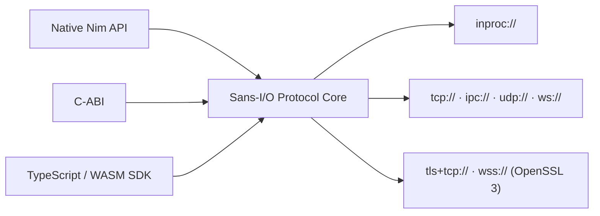

> **Experimental / Pre-Alpha Software:** `anynng` is under active development. Do not use in production systems.

## Installation

Install `anynng` via Nimble:

```bash
nimble install anynng
```

Or clone the repository from [github.com/elijahr/anynng](https://github.com/elijahr/anynng) and run the full development setup:

```bash
git clone https://github.com/elijahr/anynng.git
cd anynng
just setup
```

---

## Native Nim Usage

### Request / Reply (`REQ0` & `REP0`)

```nim title="src/reqrep_example.nim"
import anynng

let rep = openRep0()
let req = openReq0()

let listener = rep.listen("inproc://echo_service")
req.dial("inproc://echo_service")

req.send("hello anynng")
doAssert rep.hasRecv()
let requestText = rep.recvStr()
doAssert requestText == "hello anynng"

rep.send("ack: " & requestText)
doAssert req.hasRecv()
doAssert req.recvStr() == "ack: hello anynng"

listener.close()
req.close()
rep.close()
```

### Publish / Subscribe (`PUB0` & `SUB0`)

```nim title="src/pubsub_example.nim"
import anynng

let pub = openPub0()
let sub = openSub0()

let listener = pub.listen("inproc://telemetry")
sub.subscribe("metrics.")
sub.dial("inproc://telemetry")

pub.send("metrics.cpu: 42%")
pub.send("logs.info: ignored by subscriber")

doAssert sub.hasRecv()
doAssert sub.recvStr() == "metrics.cpu: 42%"
doAssert not sub.hasRecv()

listener.close()
sub.close()
pub.close()
```

---

## Architecture Overview



---

## TypeScript & WebAssembly Usage

Build the WebAssembly bridge and TypeScript package:

```bash
just build
```

Use the typed socket classes in Node.js or Browser environments:

```typescript title="example.ts"
import { Req0Socket } from "@axiomantic/anynng";

const req = new Req0Socket("ws://127.0.0.1:8080", { resendTime: 1000 });
await req.connect();

await req.send(new TextEncoder().encode("ping"));
const response = await req.recv(2000);
console.log("Received:", new TextDecoder().decode(response));

req.close();
```

---

## Running Tests & Verification

Use `just` as the canonical command runner:

```bash
just test           # Run full Nim and TypeScript/WASM test suites
just test-nng-spec  # Run upstream nanomsg/nng NUTS C-ABI specification tests
just verify-abi     # Verify C-ABI signatures & structs via HeaderKit NimBackend
just lint           # Check formatting (nph) and type-checking (nimble check, tsc)
just docs           # Launch local Starlight documentation server
```
