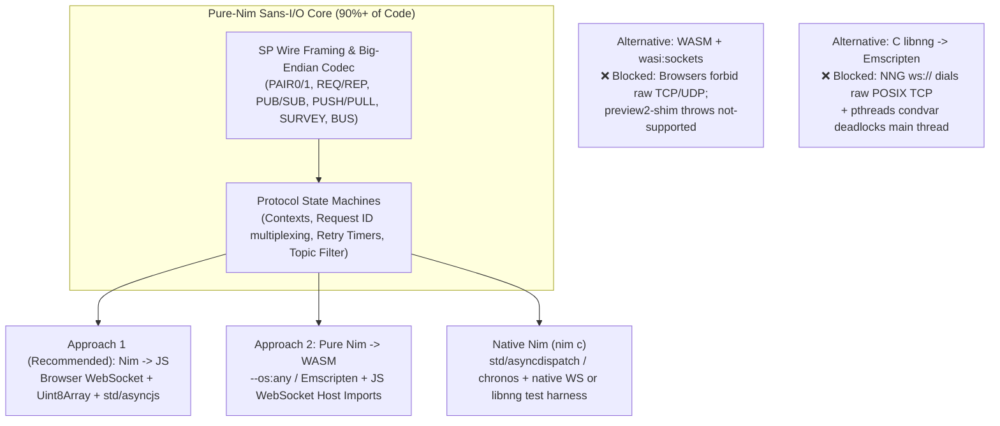

# `browser-nng`: Prior Art, Wire Protocol Specification & Nim Browser Architecture Exploration

> [!IMPORTANT]
> **Bottom Line Up Front:**
> 1. **Does it already exist in Nim?** **No** (`[VERIFIED]`). There is no pure-Nim NNG/Scalability Protocols (SP) implementation and no browser-compatible NNG package in Nimble—only C FFI bindings to `libnng` / `libnanomsg`.
> 2. **Does it exist in JS/TS/Rust?** Fragmented, partial implementations exist in JS/TS (`nanomsg-browser`, `@websdr/frontend-core`, `@secretarium/connector`, `holoplaycore.js`), each implementing only 1–3 protocols (`REQ0`, `SUB0`, or `PAIR1`). In Rust, `bpr/nng-core` (2026) recently implemented a `no_std` pure-Rust SP state machine, but its `ws` transport still relies on Tokio `TcpStream` rather than browser `WebSocket`. A complete, general-purpose browser NNG client library (covering all 6 protocol families + contexts/retry/reconnection) is an **open gap across both the Nim and broader JS/WASM ecosystems**.
> 3. **Why Pure-Nim over WebSocket works so well:** NNG's `ws://` / `wss://` transport (`sp-websocket-mapping-01`) was specifically designed so browser clients **do not** need `libnng` or raw TCP sockets. Protocol negotiation happens entirely through the standard browser `new WebSocket(url, subprotocol)` constructor (`Sec-WebSocket-Protocol`), and every SP protocol header is **0 to 4 bytes** inside a standard binary WebSocket message (`opcode = 0x2`).
> 4. **WASI Sockets vs. `nim js` vs. `nim wasm`:** Browsers do **not** expose `wasi:sockets` (TCP/UDP) for security reasons (`@bytecodealliance/preview2-shim` throws `not-supported`). However, a **Sans-I/O pure-Nim core** can share **90%+ of its codebase** across `nim js` (using native browser `WebSocket` + `std/asyncjs`), `nim wasm` (importing browser `WebSocket` via JS host imports), and `nim c` (native).

---

## Part 1: Prior Art & Ecosystem Survey

### 1.1 JavaScript / TypeScript Browser Implementations (Pure Wire Protocol)

Every working browser implementation bypasses C `libnng` entirely and speaks the **SP-over-WebSocket wire protocol** directly over the browser's `window.WebSocket` (`binaryType = "arraybuffer"`). However, each existing library only implements the subset of protocols needed for its own product:

| Project / Package | Status | Protocols Supported | Mechanism & Limitations | Confidence & Source |
| :--- | :--- | :--- | :--- | :--- |
| **`nanomsg-browser`** (npm / `OTL/nanomsg-browser`) | Unmaintained (last npm release `0.2.1` in 2021) | `REQ0`, `PAIR0`, `SUB0`, `BUS0` | ~185 LOC pure JS wrapping `new WebSocket(url, [proto])`. Generates 4-byte random `REQ` ID with bit 31 set (`hdr[0] \|= 0x80`). No concurrent `REQ` multiplexing (single in-flight ID), no `PAIR1`, `PUB0`, `REP0`, `PUSH0`/`PULL0`, or `SURVEYOR0`. | `[VERIFIED]` [npm](https://www.npmjs.com/package/nanomsg-browser) / [GitHub](https://github.com/OTL/nanomsg-browser) |
| **`@websdr/frontend-core`** (`wavelet-lab/websdr`) | Active (2026) | `REQ0`, `SUB0`, `PUB0` | ~430 LOC TypeScript (`nngWebSocket.ts`). Supports concurrent multiplexed `REQ0` calls via `_send_promises[reqId]`, incrementing 31-bit request IDs with MSB set, timeouts, and auto-reconnect. Bundled inside a SDR monorepo rather than standalone. | `[VERIFIED]` [nngWebSocket.ts](https://github.com/wavelet-lab/websdr/blob/4a7bc4829ed20f1644542b88c4fd8737588f3a47/packages/frontend-core/src/transport/nngWebSocket.ts) |
| **`@secretarium/connector`** (`secretarium/devsuite-typescript`) | Active (2026) | `PAIR1` only | Connects with `new WebSocket(url, ['pair1.sp.nanomsg.org'])` and prepends/strips the 4-byte `[0, 0, 0, 1]` hop count header (`_addHop`). | `[VERIFIED]` [nng.websocket.ts](https://github.com/secretarium/devsuite-typescript/blob/8dbb8ae8fd00a1f61f05725bfb3c6dedaaa71061/libs/connector/src/nng.websocket.ts) |
| **Looking Glass `holoplaycore.js`** | Maintained (2024) | `REQ0` only | Speaks `REQ0` (`rep.sp.nanomsg.org`) with CBOR payloads to local Looking Glass driver over `ws://localhost:11222/driver`, including `DataView` 32-bit big-endian request ID and retry timer. | `[VERIFIED]` [HoloPlayCore.js](https://github.com/Looking-Glass/holoplaycore.js/blob/bbc8ee9d968e034ab20a157847f211c44bbfd7e6/src/HoloPlayCore.js) |
| **`ElianHugh/hotwater`** & **`monome/maiden`** | Active (2026) | `SUB0` / `BUS0` only | Domain-specific clients connecting to R `nanonext` (`pub.sp.nanomsg.org`) and monome norns (`bus.sp.nanomsg.org`). | `[VERIFIED]` [hotwater](https://github.com/ElianHugh/hotwater) / [maiden](https://github.com/monome/maiden) |

### 1.2 WebAssembly, Emscripten, Rust, and Go Prior Art

| Project | Language / Target | What It Does & Browser Feasibility | Confidence & Source |
| :--- | :--- | :--- | :--- |
| **`r-lib/nanonext`** | C (`libnng`) -> Emscripten WASM (for **webR**) | Compiles `libnng` with `emcc` (`-DNNG_PLATFORM_POSIX -DNNG_PLATFORM_EMSCRIPTEN`, `posix_pollq_poll.o`, `-pthread -s PTHREAD_POOL_SIZE=16`) so R packages load inside webR. **Does NOT bind browser `window.WebSocket`**; NNG's C `ws://` transport expects POSIX TCP sockets, which cannot dial out of an unproxied browser sandbox. | `[VERIFIED]` [r-lib/nanonext](https://github.com/r-lib/nanonext/blob/main/configure) / [nng#1804](https://github.com/nanomsg/nng/issues/1804) |
| **`bpr/nng-core`** | Pure Rust (`no_std + alloc`) | Reimplements all 6 NNG protocol families in pure Rust specifically to eliminate the C/CMake `libnng` dependency for WASM and embedded targets. However, its `ws` transport (`src/transport/ws.rs`) currently uses `tokio-tungstenite` over `tokio::net::TcpStream` (`std` feature), not browser `web-sys::WebSocket`. | `[VERIFIED]` [bpr/nng-core](https://github.com/bpr/nng-core) |
| **`nanomsg/mangos` v3** | Pure Go | Uses `github.com/coder/websocket` (which supports `GOOS=js GOARCH=wasm` dialing), but `transport/ws/ws.go` bundles `net/http` server listener logic in the same file without WASM build tags and has no browser WASM release. | `[VERIFIED]` [nanomsg/mangos](https://github.com/nanomsg/mangos/blob/37bed349a33fd29ac933de4a9a16807f6f440ce5/transport/ws/ws.go) |
| **Upstream `nanomsg/nng`** | C | In [`nanomsg/nng#1903`](https://github.com/nanomsg/nng/issues/1903) (Dec 2024), NNG author Garrett D'Amore noted that browser clients should either implement the documented wire protocol directly over JS WebSockets or would require a dedicated WASM platform/transport port in NNG. | `[VERIFIED]` [nng#1903](https://github.com/nanomsg/nng/issues/1903) |

### 1.3 Nim Ecosystem Prior Art

No pure-Nim NNG/Nanomsg implementation exists, and no `nng` package is registered in Nimble's official `packages.json` (`[VERIFIED]`):
* **`axiomantic/headerkit` (`examples/nim/nng`)**: Auto-generated low-level (`nng.nim`) and high-level (`nng_highlevel.nim`) C FFI bindings to native `libnng` ([source](https://github.com/axiomantic/headerkit/tree/main/examples/nim/nng)).
* **`def-/nim-nanomsg`**: Unmaintained (2020) C FFI wrapper around legacy `libnanomsg` ([source](https://github.com/def-/nim-nanomsg)).
* **`genotrance/feud` (`wrappers/nng.nim`)** & **`envsh/tox-homeserver` (`nofia/client.nim`)**: Embedded C FFI wrappers around `libnng` ([feud](https://github.com/genotrance/feud/blob/880291cb8d571fed6d911371186bb4e225a5f64c/wrappers/nng.nim), [tox-homeserver](https://github.com/envsh/tox-homeserver/blob/c45c8e4543027eadc0c732f8b721475f9c1eab85/nofia/client.nim)).

---

## Part 2: Verified NNG WebSocket Wire Protocol Specification

All wire details below are verified directly against NNG's C implementation ([`src/sp/transport/ws/websocket.c`](https://github.com/nanomsg/nng/blob/main/src/sp/transport/ws/websocket.c), [`src/supplemental/websocket/websocket.c`](https://github.com/nanomsg/nng/blob/main/src/supplemental/websocket/websocket.c), and [`src/sp/protocol/*`](https://github.com/nanomsg/nng/tree/main/src/sp/protocol)) for both **NNG v1 (`v1.9.0`)** and **NNG v2 (`main`)**, which are **100% wire-identical** (`[VERIFIED]`).

### 2.1 Handshake & The Asymmetric `Sec-WebSocket-Protocol` Rule

Unlike TCP/IPC SP transports (which exchange an 8-byte `\0SP\0<proto><0x0000>` greeting), SP-over-WebSocket sends **zero binary handshake bytes after the HTTP upgrade**. Instead, negotiation happens via the `Sec-WebSocket-Protocol` HTTP header (`new WebSocket(url, subprotocol)` in browsers).

> [!CAUTION]
> **Critical Implementation Gotcha (Asymmetric Subprotocol Header):**
> Per [`sp-websocket-mapping-01.txt` §2](https://github.com/nanomsg/nanomsg/blob/master/rfc/sp-websocket-mapping-01.txt) and NNG's `wstran_dialer_init()` ([`src/sp/transport/ws/websocket.c`](https://github.com/nanomsg/nng/blob/main/src/sp/transport/ws/websocket.c)), **the WebSocket Client (Dialer) MUST send the Server's (Peer's) protocol name** in `Sec-WebSocket-Protocol`, NOT its own!
> Furthermore, NNG's HTTP upgrade handler (`ws_handler`) checks `ws_contains_word(l->proto, client_proto)`. Because `l->proto` is a single token (e.g., `"rep.sp.nanomsg.org"`), passing an array of multiple subprotocols in `new WebSocket(url, [p1, p2])` causes NNG to reject the handshake with **`400 Bad Request`**. Always pass the single exact peer subprotocol string!

| Browser Client Socket Role | Server (NNG Listener) Socket Role | `Sec-WebSocket-Protocol` Sent by Browser Client (`new WebSocket(url, proto)`) | Wire Header Inside Each Binary WebSocket Message |
| :--- | :--- | :--- | :--- |
| **`REQ0`** (Client sends request, awaits reply) | `REP0` (`nng_rep0_open`) | **`"rep.sp.nanomsg.org"`** | **4 bytes** (Big-Endian `uint32` Request ID with bit 31 `0x80000000` set) |
| **`REP0`** (Client receives request, sends reply) | `REQ0` (`nng_req0_open`) | **`"req.sp.nanomsg.org"`** | **4..32 bytes** (Echo back the exact 4-byte word stack up to and including the word with `byte[0] & 0x80 != 0`) |
| **`SUB0`** (Client receives published messages) | `PUB0` (`nng_pub0_open`) | **`"pub.sp.nanomsg.org"`** | **0 bytes** (Raw payload; topic prefix is at start of body; client filters locally) |
| **`PUB0`** (Client publishes messages to server) | `SUB0` (`nng_sub0_open`) | **`"sub.sp.nanomsg.org"`** | **0 bytes** (Raw payload starting with topic bytes) |
| **`PAIR0`** (Bidirectional 1-to-1 v0) | `PAIR0` (`nng_pair0_open`) | **`"pair.sp.nanomsg.org"`** | **0 bytes** (Raw payload) |
| **`PAIR1`** (Bidirectional 1-to-1 / polyamorous v1) | `PAIR1` (`nng_pair1_open`) | **`"pair1.sp.nanomsg.org"`** | **4 bytes** (Big-Endian `uint32` Hop Count: `[0x00, 0x00, 0x00, 0x01]` on send; strip 4 bytes on recv) |
| **`PUSH0`** (One-way pipeline sender) | `PULL0` (`nng_pull0_open`) | **`"pull.sp.nanomsg.org"`** | **0 bytes** (Raw payload) |
| **`PULL0`** (One-way pipeline receiver) | `PUSH0` (`nng_push0_open`) | **`"push.sp.nanomsg.org"`** | **0 bytes** (Raw payload) |
| **`SURVEYOR0`** (Broadcasts survey, collects responses) | `RESPONDENT0` (`nng_respondent0_open`) | **`"respondent.sp.nanomsg.org"`** | **4 bytes** (Big-Endian `uint32` Survey ID with bit 31 `0x80000000` set) |
| **`RESPONDENT0`** (Receives survey, replies) | `SURVEYOR0` (`nng_surveyor0_open`) | **`"surveyor.sp.nanomsg.org"`** | **4..32 bytes** (Echo back the survey backtrace stack up to `byte[0] & 0x80 != 0`) |
| **`BUS0`** (Many-to-many mesh broadcast) | `BUS0` (`nng_bus0_open`) | **`"bus.sp.nanomsg.org"`** | **0 bytes** (Raw payload) |

### 2.2 Frame & Protocol Rules to Respect (`[VERIFIED]`)

1. **Binary Frames Only (`opcode = 0x2`):**
   NNG SP sockets operate in message mode (`NNI_OPT_WS_MSGMODE = true`, `recv_text = false`). If a browser sends a WebSocket Text frame (`ws.send("string")`), NNG immediately closes the connection with WebSocket Close Code **`1003` (`WS_CLOSE_UNSUPP_FORMAT`)**. The browser client must always send `Uint8Array` / `ArrayBuffer` and set `ws.binaryType = "arraybuffer"`.
2. **1 WebSocket Message = 1 SP Message:**
   NNG concatenates `nni_msg_header(msg)` + `nni_msg_body(msg)` into a single WebSocket binary message (which the browser's `WebSocket` implementation automatically frames/fragments/masks per RFC 6455 and reassembles before firing `onmessage`).
3. **Never Send Data Frames from `SUB0` to `PUB0`:**
   In NNG's `PUB0` (`pub0_pipe_recv_cb` in `src/sp/protocol/pubsub0/pub.c`), topic filtering is **100% client-side (`SUB`-side)**. If a `SUB` client sends *any* WebSocket message to an NNG `PUB` server, NNG immediately closes the pipe (`nni_pipe_close`).
4. **Malformed Headers Close the Pipe:**
   - In `PAIR1`, if a frame is `< 4` bytes or the 32-bit big-endian hop count is `0` or `> 255` (`0xff`), NNG closes the connection (`stat_rx_malformed`). If `hop_count > ttl` (default `8`), NNG drops the message.
   - In `REQ0`/`REP0` and `SURVEYOR0`/`RESPONDENT0`, if a frame ends before encountering a 4-byte big-endian word with bit 31 (`0x80000000`) set, NNG closes the connection.

### 2.3 Native `tcp://`, `ipc://`, and `udp://` Transport Wire Framing (`[VERIFIED]`)

Because NNG cleanly decouples the **SP Protocol Layer** (`REQ0`/`REP0`, `PUB0`/`SUB0`, `PAIR0`/`1`, `PUSH0`/`PULL0`, `SURVEY0`, `BUS0`) from the **Transport Layer**, adding native transports on `nim c` requires only tiny Sans-I/O transport codecs alongside `ws://`:

| Transport | Handshake / Session Negotiation | Per-Message Framing on the Wire | Primary Source |
| :--- | :--- | :--- | :--- |
| **`ws://` / `wss://`** | HTTP `Upgrade: websocket` with `Sec-WebSocket-Protocol: <peer>.sp.nanomsg.org` (0 SP greeting bytes after upgrade) | 1 binary WebSocket message (`opcode = 0x2`) containing `sp_header \|\| sp_body` | [`src/sp/transport/ws/websocket.c`](https://github.com/nanomsg/nng/blob/main/src/sp/transport/ws/websocket.c) |
| **`tcp://` & `tls+tcp://`** | Both peers send an **8-byte greeting**: `[0x00, 'S', 'P', 0x00, proto_self_hi, proto_self_lo, 0x00, 0x00]` and verify received `proto == peer_id` | **8-byte Big-Endian `uint64` length** prefix followed by `sp_header \|\| sp_body` | [`src/sp/transport/tcp/tcp.c`](https://github.com/nanomsg/nng/blob/main/src/sp/transport/tcp/tcp.c) |
| **`ipc://`** | **8-byte greeting**: `[0x01, 'S', 'P', 0x00, proto_self_hi, proto_self_lo, 0x00, 0x00]` over Unix domain socket / named pipe | **8-byte Big-Endian `uint64` length** prefix followed by `sp_header \|\| sp_body` | [`src/sp/transport/ipc/ipc.c`](https://github.com/nanomsg/nng/blob/main/src/sp/transport/ipc/ipc.c) |
| **`udp://` (NNG v2)** | Stateless/lightweight 8-byte `CREQ` (`op=1`) -> `CACK` (`op=2`) negotiation & periodic refresh (`recvmax`, `refresh` secs) | **8-byte `udp_sp_msg` header** (`ver: u8`, `opcode: u8`, `proto_type: u16`, `param0_len: u16`, `param1: u16`) + `sp_header \|\| sp_body` in a single UDP datagram | [`src/sp/transport/udp/udp.c`](https://github.com/nanomsg/nng/blob/main/src/sp/transport/udp/udp.c) |
| **`inproc://`** | Zero-copy in-memory pipe matching `proto_self == peer.proto_peer` | Direct in-memory `SpMsg` delivery | [`src/sp/transport/inproc/inproc.c`](https://github.com/nanomsg/nng/blob/main/src/sp/transport/inproc/inproc.c) |

---

## Part 3: Evaluating Nim Compilation Targets (`wasi:sockets` vs. `wasm` vs. `nim js`)



### Why `wasi:sockets` and C `libnng -> WASM` Fail in Standard Browsers (`[VERIFIED]`)

1. **`wasi:sockets` (`WASIp2` / `wasi-sockets`) has NO browser implementation:**
   * Browsers forbid raw TCP (`SOCK_STREAM`) and UDP (`SOCK_DGRAM`) sockets from web pages.
   * In Bytecode Alliance's official browser polyfill (`@bytecodealliance/preview2-shim`, `lib/browser/sockets.js`), `wasi:sockets/tcp` and `wasi:sockets/udp` throw **`not-supported`** unless routed through an external WebSocket-to-TCP proxy server (`websockify`).
   * `wasi:http` maps to `fetch()`, which forbids setting `Upgrade: websocket` headers. And `WebAssembly/wasi-websocket` is still an unshipped Phase 1 proposal.
2. **Compiling C `libnng` via Emscripten does not work for browser `ws://`:**
   * Native `libnng` implements `ws://` (`src/sp/transport/ws/websocket.c`) on top of **raw POSIX TCP sockets** (`nng_stream_dialer` -> `posix_tcp`) and performs its own HTTP/1.1 `Upgrade: websocket` handshake and RFC 6455 masking in C.
   * Furthermore, `libnng`'s core engine (`src/core/taskq.c`, `src/platform/posix/`) relies heavily on `pthreads`, `pthread_cond_wait`, and `poll()`/`epoll()`. In a browser, `-pthread` requires `SharedArrayBuffer` (forcing strict `COOP`/`COEP` server headers), and blocking on condition variables on the main thread deadlocks browser WebSocket event delivery.

---

## Part 4: Candidate Architectures for `browser-nng`

### Approach 1 (Recommended): Sans-I/O Pure-Nim Core Targeting `nim js` First (with Optional Native & WASM Backends)

Structure `browser-nng` into two cleanly separated layers:
1. **`browser_nng/core` (Pure Nim, target-agnostic, compiles on `nim c`, `nim js`, and `nim wasm`):**
   * Implements `SpMsg` (`header: seq[byte]`, `body: seq[byte]`), big-endian 32-bit packing/unpacking, backtrace hop parsing (`0x80000000` marker), `PAIR1` hop headers, `SUB0` prefix matcher, and `REQ0`/`SURVEYOR0` request ID allocation, multiplexing (`Table[uint32, PendingRequest]`), and retry/resend state machines.
2. **`browser_nng/transport/ws_js` (`when defined(js)`):**
   * Thin ~120 LOC adapter using Nim's `std/jsffi` and `std/asyncjs` over the browser's `WebSocket`, `ArrayBuffer`, and `Uint8Array`.

* **Pros:**
  * **Zero WASM/Emscripten friction:** Compiles with `nim js` directly to a tiny, dependency-free `.js` ES module (can also emit TypeScript `.d.ts` declarations if JS/TS consumers want to use it!).
  * **Native Promise integration:** `std/asyncjs` compiles Nim `{.async.}` procedures directly to native JS `async`/`await` returning standard JS `Promise`s.
  * **Zero-copy buffer views:** `Uint8Array` views over `ArrayBuffer` pass straight to `ws.send()`.
  * **Testable against real C `libnng`:** Because `browser_nng/core` compiles on `nim c` too, you can test the exact wire codec on native C and run headless browser or Node WebSocket tests against a real C `libnng` server!
* **Cons:**
  * If an application is *already* compiled entirely to `wasm32` in Nim, calling `nim js` code requires crossing the WASM <-> JS boundary at the application level rather than keeping socket calls inside WASM linear memory.

### Approach 2: Sans-I/O Pure-Nim Core + Dual `nim js` and `nim wasm` (`emscripten` / `wasmrt`) Transport Backends

Use the **exact same** `browser_nng/core` Sans-I/O protocol engine from Approach 1, and add a second thin transport adapter (`browser_nng/transport/ws_wasm.nim`) for Nim code compiled to `wasm32`:
* When compiling with **Emscripten (`-d:emscripten`)**, wrap `<emscripten/websocket.h>` (`emscripten_websocket_new`, `emscripten_websocket_send_binary`, `emscripten_websocket_set_onmessage_callback`). Notice that `EmscriptenWebSocketCreateAttributes` has a `protocols` field that sets `Sec-WebSocket-Protocol`!
* Or when compiling to **standalone `wasm32-unknown-unknown` (`--os:any -d:wasm`)**, use a 30-line JS host import module (`wasmrt`) that bridges `ws_open`, `ws_send`, and `on_ws_msg` across WASM linear memory.

* **Pros:**
  * Supports **both** `nim js` apps and pure `nim wasm32` apps (e.g., Nim WebGL/Canvas/WASM apps) from a single library with >90% shared code.
* **Cons:**
  * Slightly more build/CI setup to test both `nim js` and `emcc` / `wasm32` targets.

### Approach 3: Minimal `nim js`-Only Client Library

Write `browser-nng` exclusively for `--backend:js`, storing headers and payloads directly in JS `Uint8Array` / `DataView` objects without a target-agnostic `seq[byte]` Sans-I/O layer.

* **Pros:** Slightly fewer conversions between `Uint8Array` and `seq[byte]` (or `openArray[byte]`).
* **Cons:** Cannot share the protocol state machines with `nim c` (native) or `nim wasm` targets, and cannot run native `nim c` unit tests on the protocol state machines.

---

## Part 5: Concrete Nim Code Sketch (Sans-I/O Core + `nim js` Browser WebSocket)

Below is how clean a working `browser-nng` implementation looks in Nim:

```nim
# src/browser_nng/wire.nim — 100% Pure Nim (compiles on nim js, nim c, and nim wasm)
type
  SpProto* = enum
    spPair0, spPair1, spPub0, spSub0, spReq0, spRep0,
    spPush0, spPull0, spSurveyor0, spRespondent0, spBus0

func peerSubprotocol*(proto: SpProto): string =
  ## Returns the exact Sec-WebSocket-Protocol string expected by an NNG listener.
  ## Per sp-websocket-mapping-01, the dialer MUST send its PEER's protocol name!
  case proto
  of spPair0:       "pair.sp.nanomsg.org"
  of spPair1:       "pair1.sp.nanomsg.org"
  of spPub0:        "sub.sp.nanomsg.org"
  of spSub0:        "pub.sp.nanomsg.org"
  of spReq0:        "rep.sp.nanomsg.org"
  of spRep0:        "req.sp.nanomsg.org"
  of spPush0:       "pull.sp.nanomsg.org"
  of spPull0:       "push.sp.nanomsg.org"
  of spSurveyor0:   "respondent.sp.nanomsg.org"
  of spRespondent0: "surveyor.sp.nanomsg.org"
  of spBus0:        "bus.sp.nanomsg.org"

func putBeU32*(buf: var openArray[byte], offset: int, val: uint32) {.inline.} =
  buf[offset + 0] = byte((val shr 24) and 0xff'u32)
  buf[offset + 1] = byte((val shr 16) and 0xff'u32)
  buf[offset + 2] = byte((val shr 8) and 0xff'u32)
  buf[offset + 3] = byte(val and 0xff'u32)

func getBeU32*(buf: openArray[byte], offset: int): uint32 {.inline.} =
  (uint32(buf[offset + 0]) shl 24) or
  (uint32(buf[offset + 1]) shl 16) or
  (uint32(buf[offset + 2]) shl 8) or
  uint32(buf[offset + 3])

func encodeReq0Frame*(reqId: uint32, payload: openArray[byte]): seq[byte] =
  ## Prepends 4-byte Big-Endian Request ID with bit 31 (0x80000000) set.
  result = newSeq[byte](4 + payload.len)
  putBeU32(result, 0, reqId or 0x80000000'u32)
  for i in 0 ..< payload.len:
    result[4 + i] = payload[i]

func encodePair1Frame*(payload: openArray[byte], hopCount: uint32 = 1'u32): seq[byte] =
  ## Prepends 4-byte Big-Endian hop count (default 1 in cooked mode).
  result = newSeq[byte](4 + payload.len)
  putBeU32(result, 0, hopCount and 0xff'u32)
  for i in 0 ..< payload.len:
    result[4 + i] = payload[i]
```

And the browser WebSocket FFI in `when defined(js):`:

```nim
# src/browser_nng/ws_js.nim — Nim JS backend binding to native browser WebSocket
when defined(js):
  import std/[asyncjs, jsffi]

  type
    JsWebSocket* {.importc: "WebSocket".} = ref object of JsRoot
      readyState*: cint
      binaryType*: cstring
      onopen*: proc(ev: JsObject)
      onmessage*: proc(ev: JsObject)
      onerror*: proc(ev: JsObject)
      onclose*: proc(ev: JsObject)

    Uint8Array* {.importc: "Uint8Array".} = ref object of JsRoot
      length*: cint

  proc newJsWebSocket*(url, subprotocol: cstring): JsWebSocket
    {.importcpp: "new WebSocket(#, #)".}
  proc newUint8Array*(buf: JsObject): Uint8Array
    {.importcpp: "new Uint8Array(#)".}
  proc newUint8Array*(len: cint): Uint8Array
    {.importcpp: "new Uint8Array(#)".}
  proc sendBinary*(ws: JsWebSocket, data: Uint8Array)
    {.importcpp: "#.send(#)".}
  proc close*(ws: JsWebSocket, code: cint = 1000)
    {.importcpp: "#.close(#)".}
```
